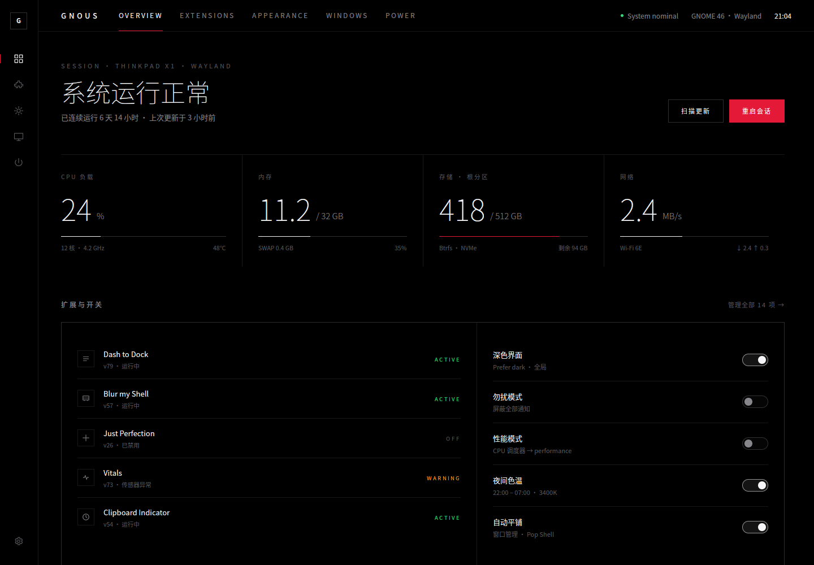

# GNOUS

本机 GNOME 管理面板。

## 开发宗旨

**体验好、性能好、灵活性强，不惜增加开发成本。**

这三条优先于开发成本：只要能换来更好的体验、更高的性能或更强的灵活性，多写、重写、自建一层都是可接受的；反过来，为省事而复用现成实现、把产品绑死在别人的接口约定上，不做。

所有功能取舍与架构选择都以这三条为准。遇到“复用现成实现”和“多一层自己的抽象”的取舍时，优先自己的抽象：可以薄，但必须清晰、可控。

## 技术栈

- **语言**：Rust（edition 2024）
- **UI 框架**：[GPUI](https://github.com/longbridge/gpui-kit)（`gpui-kit`，含 `gpui-base` 行为层与 `gpui-component` 样式组件层）

## 当前进度

**A · Control Deck**（`demo/ui-directions/a-cockpit.html`）已用 Rust + GPUI 复刻，概览页已接入真实系统数据：

- 主机名 / 会话 / 运行时长 / 时钟，CPU、内存、根分区、网络四项指标，每秒从 procfs·sysfs 重新采样。
- 扩展列表来自真实安装目录；点击行打开右侧详情面板（描述、版本、来源、支持的
  GNOME 版本、有无首选项），面板内按钮启用/禁用，写回 gsettings。
- 右侧快捷开关也是真数据：深色界面（`color-scheme`）、勿扰（`show-banners` 反向）、
  性能模式（`powerprofilesctl`）、夜间色温（`night-light-enabled`）；系统没有对应
  schema / 命令的开关会显示为不可用并说明原因，而不是假装有个值。

- 导航分两层：左列 rail 选分区（Overview / Extensions / Appearance / Devices / Power），
  顶栏 tab 是该分区内的页面（如 Overview → Overview / Processes）。两者共用一份
  `Nav` 状态，所以永远同步；未实现的页面显示占位而不是假数据。

- 进程页已按 `docs/EXTENSIONS.md` 做成第一个页面级扩展：`extensions/processes/manifest.toml`
  声明 5 个视图（Table / CPU / Memory / Tree / Groups），顶栏 tab 由 registry 生成，五种视图共用
  同一份 `/proc` 采样，支持点击选中与进程操作确认。
- Table 页 P0：表头排序、直接输入搜索（名称 / PID / 用户）、全部/我的/系统范围过滤、
  暂停刷新、排序冻结、选中行详情栏（含长命令行）、表头吸顶（表体独立滚动）。
- Table 页 P1：右键菜单收拢进程操作；SIGTERM / SIGKILL / SIGSTOP / SIGCONT 都必须经过
  确认对话框（显示进程名、PID、完整命令行和信号后果，`Enter` 确认、`Esc` 取消）；
  复制整行 TSV 或命令行到剪贴板与 X11 primary selection，操作结果显示短时 toast。
  键盘：`Ctrl+1/2/3` 切范围、`Ctrl+Space` 暂停刷新、`Ctrl+F` 排序冻结、
  `Ctrl+K` / `Ctrl+Shift+K` 结束/强杀、`Ctrl+P` / `Ctrl+Shift+P` 暂停/继续进程、
  `Ctrl+C` / `Ctrl+Shift+C` 复制行/命令行、`Esc` 清空；普通字符始终进入搜索。
- Table 页 P2（Table 封版）：状态过滤、只看热点（CPU 阈值或常驻内存 ≥ 512 MB）、
  关注置顶与「只看关注」（按进程名 + 用户 + uid 持久化，避免 PID 复用）、完整键盘操作
  （`↑/↓/PgUp/PgDn/Home/End` 选行并滚动跟随、`Enter` 结束、`Delete` 强杀）、
  0.5s / 1s / 2s / 5s 刷新频率、两帧真实采样差分驱动的变化高亮、三种行密度、
  本地操作日志（信号/关注/刷新/暂停，最多 200 条，可复制 TSV）。
  新增 `Ctrl+T` 状态、`Ctrl+H` 热点、`Ctrl+W` 关注、`Ctrl+R` 刷新、`Ctrl+G` 密度、
  `Ctrl+L` 日志；偏好与日志写入 `~/.config/gnous/table.json`（临时文件 + rename 原子写）。
  Table 的选中、搜索、滚动位置不持久化，信号执行仍一律经过确认对话框。
- 新增页面级扩展 `startup-layouts`（左列独立分区 Startup）：勾选开机要铺开的桌面页面、给每页
  按比例排列窗口、配置启动时机与失败策略；配置自动写入 `~/.config/gnous/startup.json`。
  「预演一遍」真实解析每个启动命令在 `PATH` 里是否存在；执行器未接入前，「上次启动」与
  「启动日志」保持空态，不用演示数据充数。第四个视图「项目」登记自研启动项目脚本：
  `~/.config/gnous/projects/<id>/` 下的 `project.toml` + 脚本，磁盘上有什么就列什么，
  缺清单 / 缺脚本 / 缺可执行位分别标出，勾选开机直接改写项目自己的清单。
- 滚动指示器选了 `demo/scroll-indicators` 里的 **10 · LED 刻度**：右侧 26 根 2px 刻度，
  滚过的变暗红、当前位置那根拉长成亮红。整列既是指示器也是把手 —— 点哪跳哪、按住可连续拖；
  再加键盘 `↑` `↓` `PgUp` `PgDn` `Home` `End`，所以滚轮坏了也能走完整个页面。
  两个滚动区（页面外层 / 进程表体）各自独立跟踪一份 scroll handle。
- 页面级扩展按 `docs/EXTENSIONS.md` 的 manifest + registry 机制接入：
  `gnome-fixes` 把 5 个 GNOME 小补丁收成「体检 / 应用 / 回退」；其中剪贴板与 root
  桌面对齐已内建为 `src/fixes_backend/` 的 Rust 后端（结构化 facts / JSON 状态 / 审计日志），
  `root-align` 是同一后端的 C 方案诊断台，按功能域列出 8 个 systemd 用户单元；
  `proxy-tools` 把本机代理中继（原本是 `/home/root/GNOME` 里的 python + bash 脚本）
  重写成自带的标准库 Rust 中继，并给出只读诊断台：旧单元只读、危险 systemd 动词
  在接口层不存在、交棒命令只打印不执行。
  另外 3 项仍走外部工具，输出不明时显示失败原因而不伪造状态；危险动作二次确认，
  `restart-shell` 不进入批量流程。
- 顶栏同时是客户端标题栏：拖动、双击最大化、右键原生窗口菜单，四边四角提供隐形缩放热区。

当前版本：`0.2.0-preview.5`。Appearance / Devices / Power 分区与启动器仍是静态占位；
剩余外部工具默认在 `/home/root/GNOME`，可用 `GNOUS_FIXES_ROOT` 覆盖；内建后端状态在
`~/.local/state/gnous/fixes/`，可用 `GNOUS_STATE_HOME` 覆盖。发布记录见 `CHANGELOG.md`。



## 运行

```bash
export PATH="$HOME/.cargo/bin:$PATH"   # 需要 rustup 的 stable（>= 1.92）
cargo run                         # 开发版
cargo run --release              # 本机发布版
./target/release/gnous --version # 打印应用版本
```

本机安装入口为 `/usr/local/bin/gnous`，桌面入口为 `/usr/local/share/applications/gnous.desktop`。
从已构建的 release 产物安装或回滚到本机最新包：

```bash
sudo ./packaging/install-release.sh ./target/release/gnous
```

脚本会校验版本、备份被替换的旧文件、安装 `/usr/local/bin/gnous` 与 desktop/icon，
并刷新 desktop/icon 缓存；备份保存在 `/usr/local/share/gnous/release-backups/`。

## 源码结构

```
src/
├── main.rs    # 窗口、图标栏、顶栏、概览各区块的布局
├── sys.rs     # 只读系统采样（procfs / sysfs + statvfs），输出一帧 Snapshot
├── ext.rs     # 扩展清单：Provider 抽象 + 文件/gsettings 默认后端
├── registry.rs # 编译期插件注册表：解析 extensions/*/manifest.toml，生成顶栏页面
├── proc.rs    # 进程采样：/proc/<pid>/stat + status，CPU 差分、用户名、cgroup
├── table_state.rs # Table 视图的筛选 / 排序 / 置顶 / 变化检测 / 行密度 / 刷新频率
├── table_prefs.rs # Table 偏好与操作日志的本地持久化（~/.config/gnous/table.json）
├── scroll.rs  # LED 滚动指示器状态（刻度、拖动、键盘跳转）
├── fixes.rs   # gnome-fixes 的清单、外部命令解析与体检状态
├── fixes_backend/ # clipfix / root-align 共用的内建 Rust 后端、JSON 状态与审计
├── root_align.rs # root-align 页面状态与内建后端适配
├── proxy_tools/ # 代理工具内建后端：guard 闸门 / std 中继 / 只读诊断 / 配置
├── pages/     # 页面级扩展渲染器：processes / gnome_fixes / root_align / proxy_tools
├── toggles.rs # 右侧快捷开关：gsettings bool/choice 与外部命令，缺失即置灰
├── theme.rs   # 设计 token（颜色 / 字体 / 字距 / 行高）与文本辅助函数
└── icons.rs   # 内联 SVG 线性图标（stroke 1.3，与 demo 完全一致）
```

采样很快（全是 procfs/sysfs 小文件读取），所以刷新循环直接跑在 UI 线程上，
每秒一次，不引入额外线程或锁。扩展清单每 10 秒重扫一次，避免频繁拉起 `gsettings`。

### 扩展后端

`extension-manager`（本机装了 0.6.3）是纯 GTK 前端，没有 D-Bus 服务也没有 CLI；
`org.gnome.Shell.Extensions` 又要求用户会话总线，且把数据模型绑死在 GNOME 的规则上。
所以 GNOUS 自己定了一层 `ext::Provider`：

| 后端 | 状态 | 说明 |
|---|---|---|
| `FilesystemProvider` | 默认 | 直接读 `metadata.json` + gsettings `enabled-extensions`，离线可用、无需 D-Bus |
| GNOME Shell D-Bus | 计划 | 可选，补运行时状态与扩展报错 |
| GNOUS 原生扩展 | 计划 | 通过 `GNOUS_EXTENSIONS_DIR` 的目录被扫描，不要求符合 GNOME 约定 |

`Provider` 只有三个方法（`id` / `list` / `set_enabled`），加新后端不需要动 UI。

复刻时的几个关键处理：

- 纯黑底 + 0.09/0.18 两种 alpha 的 hairline 线，模仿 Tesla 中控屏的观感。
- GPUI 没有 `letter-spacing`，用逐字 `mr()` 实现等价的字距（连最后一个字的尾距也与 CSS 一致）。
- GPUI 默认行高是 1.618（黄金比），会撑高每一行；统一改为 1.538，对齐 demo 在浏览器里的 `line-height: normal`。
- 滚动区右侧预留 12px，等价于 demo 里浏览器滚动条占用的宽度，保证各分栏边界像素对齐。
- 图标用 `Icon::data()` 直接内嵌 demo 的 SVG 路径，绕开 gpui-kit 图标集较粗的 2px 描边。

## 结构

```
demo/                     # 所有 demo，每个 demo 一个子文件夹
└── ui-directions/        # UI 方向选型（已选定 A · Control Deck）
```
